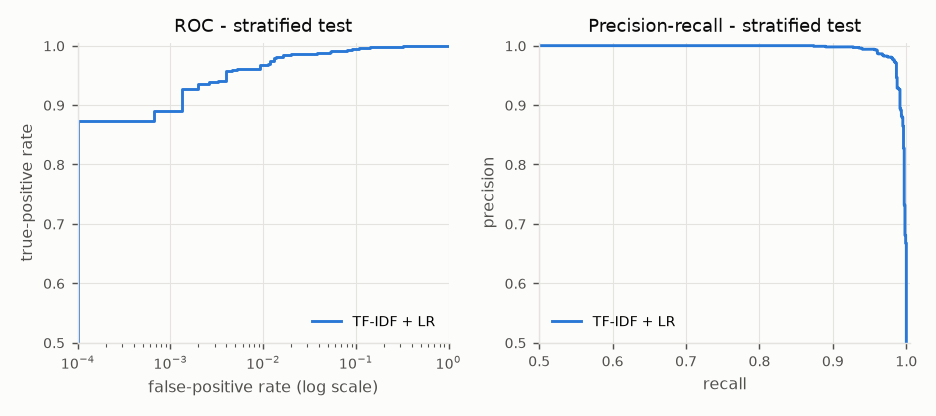
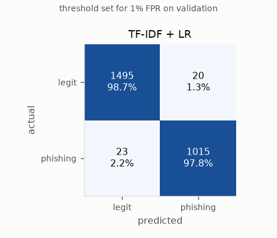
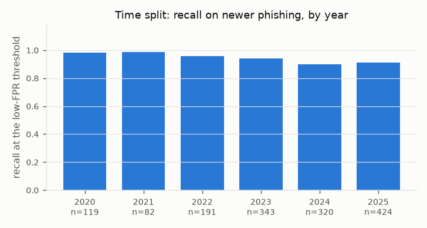
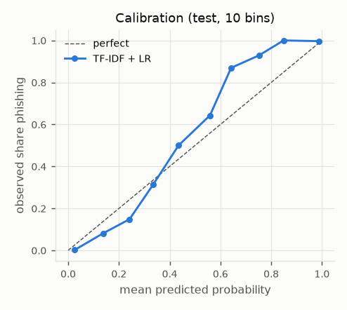
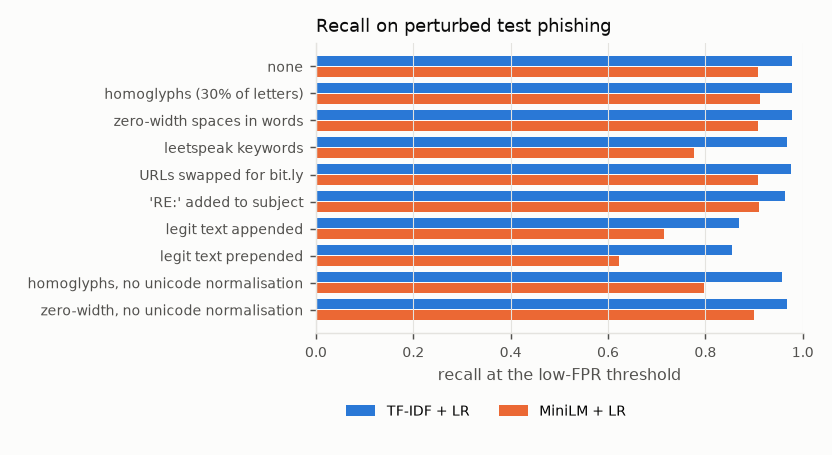

# Phishing email detection: small trained models and an LLM harness

All numbers here come from runs of the scripts in this repository on
2026-09-03, on a laptop CPU (Intel i7-1360P, 16 logical cores, WSL2, Python
3.12). The LLM classifier is built and tested offline but **has not been run
against a paid API**, so this report has no LLM accuracy, cost or latency
results, only the commands that will produce them.

## Summary

* Two models were trained on 12,765 deduplicated public emails: phishing from
  the Nazario corpus (2004-2025) and legitimate mail from SpamAssassin and Enron
  (2001-2002).
* The main risk with this data is **leakage between corpora**. The same
  TF-IDF model trained on the raw messages scores a perfect ROC-AUC of 1.0000,
  and its top features are years, `enron`, `monkey.org` and `jose` (the
  phishing corpus belongs to Jose Nazario) and mail-server names. The cleaning
  in `data/README.md` removes those shortcuts; section 3 shows what is left.
* On a test set split by near-duplicate group, **TF-IDF (word + character
  n-grams) + logistic regression** reaches ROC-AUC 0.9978. With the threshold
  set for a 1% false-positive rate on validation it catches 97.8% of test
  phishing at a 1.3% test false-positive rate.
* The **MiniLM sentence-embedding model** is weaker on the ranking metrics
  (ROC-AUC 0.9921; 90.8% recall at 1.6% FPR) and about 14 times slower per
  email, though better calibrated. Frozen general-purpose embeddings lose the
  surface cues (look-alike hosts, odd spellings) that character n-grams catch.
* **Drift.** On 2020-2025 phishing, TF-IDF recall is 97.6% when similar
  campaigns were in training (stratified split) but 92.3% when it is trained
  only on phishing from before 2020. For MiniLM: 88.5% vs 78.5%.
* **Prevalence.** The test set is 41% phishing. At a realistic 1% phishing
  rate the same TF-IDF operating point would give precision of about 43%:
  most alerts would be false alarms.
* Errors cluster in legitimate transactional mail (bills, password resets,
  orders) and in phishing padded with innocent text; a share of the "errors"
  are label noise in the corpora.

## 1. Question

Can a small model that runs locally in milliseconds separate phishing from
legitimate email well enough to be useful, how does it compare with asking a
general-purpose LLM, and what does each cost in money, latency and privacy?

## 2. Data

Full details, licences and per-step counts: [`data/README.md`](data/README.md).

| | legitimate | phishing |
|---|---|---|
| sources | SpamAssassin public corpus (easy_ham, easy_ham_2, hard_ham): 4,022; Enron inbox sample: 3,551 | Nazario phishing corpus: 5,192 |
| years | 2001-2002 | 2004-2007 and 2015-2025 |
| stratified split, train / val / test | 5,300 / 758 / 1,515 | 3,635 / 519 / 1,038 |
| time split, train / val / test | 5,300 / 758 / 1,515 | 3,235 / 462 / 1,480 |

Pipeline: parse MIME and keep only the subject and body; clean (section 3);
drop empty and non-English mail; remove exact duplicates; group near-duplicates
(word 3-gram cosine >= 0.8) and cap each group at 3 messages, so a campaign
with 69 near-identical copies counts as 3; split with every group on one side,
so the test set measures detection of unseen campaigns rather than
memorisation.

The **time split** trains on phishing delivered before 2020 and tests on
phishing from 2020 to 2025 (dropping 15 test emails whose campaign also
appears before 2020). The legitimate mail only covers 2001-2002, so it keeps
its stratified assignment: this measures drift in phishing, not a full
deployment over time.

A side set of 1,695 SpamAssassin **spam** messages, never trained on, shows
what the models make of ordinary spam.

## 3. Leakage

Phishing and legitimate mail come from different corpora collected 20 years
apart by different people. `scripts/leakage_check.py` trains the same TF-IDF +
logistic regression (C=3) on three views of the same split
(`results/leakage.md`):

| input | ROC-AUC | PR-AUC | recall at 1% val FPR | test FPR |
|---|---|---|---|---|
| raw message (headers + MIME body) | 1.0000 | 1.0000 | 1.0000 | 0.73% |
| parsed (subject + decoded body, no cleaning) | 0.9995 | 0.9993 | 0.9884 | 1.19% |
| cleaned (the input used everywhere else) | 0.9984 | 0.9980 | 0.9817 | 1.25% |

Top features of the model trained on raw messages:

| towards phishing | towards legitimate |
|---|---|
| `example com` | `2002` |
| `monkey org` | `enron` |
| `jose` | `enron com` |
| `2006`, `2005` | `2001` |
| `domain com` | `taint org` (SpamAssassin's host rewrite) |
| `hostedemail com` (a mail host in Nazario's headers) | `spamassassin`, `localhost` |
| `3d` (quoted-printable `=3D` in raw HTML) | `pst` (Enron's time zone) |

The raw model is perfect and useless: it recognises the corpus, not phishing.
Decoding the body and dropping headers (**parsed**) still leaves `enron`,
`2002`, `jose`, `monkey org` and Houston's `713` area code among the top
features. The **cleaned** view replaces recipient organisations, the corpus
owner's name, email addresses, phone numbers, years and dates with
placeholders, keeps only the host of each URL, removes reply quoting,
signatures, mailing-list footers, subject tags added by upstream spam filters
("[*** POSIBLE SPAM***]") and virus-scanner footers, decodes charsets strictly,
and drops non-English mail. Every step and its reason is in `data/README.md`.

Three artefacts only showed up when reading top features and counts after a
first round of cleaning, and were then fixed: the `713` area code; U+FFFD
replacement characters from lenient decoding (605 phishing emails vs 47
legitimate); and a `RECIPIENT` placeholder for the corpus owner's name that
appeared in 9.5% of phishing and 0.1% of legitimate mail, because only his
name was being replaced. What cannot be cleaned away is topic: `gas`, `energy`
and `houston` lean legitimate because of Enron, and `url:newsisfree.com` (an
RSS-to-email feed in SpamAssassin) is a legitimate-leaning feature.

The cleaned score is still very high. On this data the task is easier than
real-world phishing detection; the number is not a forecast for a real inbox.

## 4. Method

**TF-IDF + logistic regression** (`src/phishdet/baseline.py`). Word 1-2 grams
(100k features, `url:host` kept as one token) and character 3-5 grams inside
word boundaries (150k features), sublinear TF, logistic regression with
balanced class weights. C is the smallest value within 0.001 validation
average precision of the best (C=1): the differences between C values were
tiny and a more regularised model is the safer bet under drift.

**MiniLM + logistic regression** (`src/phishdet/embedding.py`).
`sentence-transformers/all-MiniLM-L6-v2` (22M parameters, Apache-2.0, pinned
revision), frozen; normalised 384-d embeddings of the first 256 word pieces of
the cleaned email; logistic regression head (C=3, same selection rule).
Embedding all 14,460 emails took 411 s on 8 CPU threads with about 1.3 GB peak
RAM. A short DistilBERT fine-tune was the alternative; on a shared machine with
a ~3 GB budget the frozen encoder was the safer choice, and a fine-tuned
encoder may well do better (section 11).

**LLM classifier** (`src/phishdet/llm/`). A small provider interface with
OpenAI (`/v1/chat/completions`, JSON mode) and Anthropic (`/v1/messages`)
implementations over plain HTTP with retries, plus a fake provider for offline
tests. Zero-shot and few-shot prompts ask for
`{"label", "confidence", "reason"}`. The four few-shot examples are short emails
written for this project, so the prompt carries no extra corpus text and no
test emails. The email is fenced in `<email>` tags, the model is told that the
content is untrusted data, and `<email>` tags inside the email are neutralised
so a phishing email cannot close the fence and append instructions. Replies are
validated; unusable replies are counted and treated as "legitimate" (what a
filter does when its classifier fails). Each call records tokens, cost (from a
hand-entered price table in `src/phishdet/llm/pricing.py`) and latency.
`scripts/run_llm_eval.py` runs on a fixed, committed sample of 100 phishing +
100 legitimate test emails and will not call a paid API without `--yes`.

**Evaluation** (`src/phishdet/metrics.py`, `scripts/evaluate.py`). ROC-AUC,
PR-AUC, and precision / recall / F1 at a 0.5 threshold and at a **low-FPR
threshold**: the lowest threshold with at most 1% false positives on the
validation set (7 of 758 legitimate emails), applied unchanged to test.
Calibration as reliability curves, Brier score and expected calibration error
(ECE, 10 bins). Latency end to end on this laptop.

## 5. Results

### 5.1 Stratified test set (2,553 emails, 1,038 phishing)

| model | ROC-AUC | PR-AUC | P / R / F1 at 0.5 | low-FPR threshold | P / R / F1 at threshold | test FPR | FP / FN | Brier | ECE |
|---|---|---|---|---|---|---|---|---|---|
| TF-IDF + LR | 0.9978 | 0.9972 | 0.983 / 0.972 / 0.977 | 0.439 | 0.981 / 0.978 / 0.979 | 1.3% | 20 / 23 | 0.019 | 0.056 |
| MiniLM + LR | 0.9921 | 0.9899 | 0.945 / 0.959 / 0.952 | 0.792 | 0.975 / 0.908 / 0.940 | 1.6% | 24 / 96 | 0.031 | 0.014 |
| LLM zero-shot (Anthropic claude-haiku-4-5) | not run yet | | | | | | | | |
| LLM few-shot (Anthropic claude-haiku-4-5) | not run yet | | | | | | | | |
| LLM zero-shot (OpenAI gpt-4o-mini) | not run yet | | | | | | | | |
| LLM few-shot (OpenAI gpt-4o-mini) | not run yet | | | | | | | | |

P = precision, R = recall. To fill the LLM rows, with the API key in the
environment (`ANTHROPIC_API_KEY` or `OPENAI_API_KEY`):

```
python scripts/run_llm_eval.py --provider anthropic --model claude-haiku-4-5 --mode zero-shot --yes
python scripts/run_llm_eval.py --provider anthropic --model claude-haiku-4-5 --mode few-shot --yes
python scripts/run_llm_eval.py --provider openai --model gpt-4o-mini --mode zero-shot --yes
python scripts/run_llm_eval.py --provider openai --model gpt-4o-mini --mode few-shot --yes
```

These run on the 200-email sample, not the full test set; section 5.7 has the
trained models on that same sample. Each run writes
`results/llm/<provider>__<model>__<mode>.json`.





The ROC curve is drawn with a log-scale FPR axis because that is where the
models differ: at an FPR of 0.1% the TF-IDF model still has close to 90%
recall, MiniLM about 73%.

### 5.2 Time split: trained on phishing before 2020, tested on 2020-2025

Test: 2,995 emails, 1,480 phishing.

| model | ROC-AUC | PR-AUC | P / R / F1 at 0.5 | low-FPR threshold | P / R / F1 at threshold | test FPR | FP / FN | Brier | ECE |
|---|---|---|---|---|---|---|---|---|---|
| TF-IDF + LR | 0.9950 | 0.9952 | 0.991 / 0.893 / 0.939 | 0.411 | 0.987 / 0.923 / 0.954 | 1.2% | 18 / 114 | 0.048 | 0.106 |
| MiniLM + LR | 0.9807 | 0.9820 | 0.964 / 0.896 / 0.929 | 0.743 | 0.981 / 0.785 / 0.872 | 1.5% | 23 / 319 | 0.053 | 0.051 |



Recall at the low-FPR threshold, by year (TF-IDF / MiniLM): 2020 97.5% /
79.0%, 2021 98.8% / 87.8%, 2022 94.2% / 80.6%, 2023 93.0% / 79.6%, 2024 89.7% /
72.5%, 2025 90.1% / 79.0%. Both models lose recall on campaigns they have not
seen, most in 2024. The TF-IDF model's calibration also degrades (ECE 0.106 vs
0.056): its scores for new campaigns drift towards the middle, which is why
its recall at 0.5 (89.3%) is lower than at its 0.411 threshold.

### 5.3 Where the errors are (stratified test, low-FPR threshold)

| group | n | TF-IDF + LR | MiniLM + LR |
|---|---|---|---|
| legitimate: SpamAssassin easy_ham | 476 | FPR 0.0% | FPR 0.4% |
| legitimate: SpamAssassin easy_ham_2 | 286 | FPR 0.0% | FPR 0.3% |
| legitimate: SpamAssassin hard_ham | 42 | FPR 2.4% | FPR 4.8% |
| legitimate: Enron inbox | 711 | FPR 2.7% | FPR 2.7% |
| phishing 2004-2007 | 501 | recall 96.8% | recall 88.8% |
| phishing 2015-2019 | 249 | recall 100.0% | recall 97.2% |
| phishing 2020-2025 | 288 | recall 97.6% | recall 88.5% |

19 of the TF-IDF model's 20 false positives are Enron mail. Mailing-list
traffic is easy to tell apart; corporate mail with bills, orders and password
resets is what looks like phishing. hard_ham is small (42 test emails), so its
rates are one or two emails.

### 5.4 Precision at realistic prevalence

Holding each model's test recall and FPR at the low-FPR threshold fixed:

| model | test set (41% phishing) | 10% phishing | 1% phishing |
|---|---|---|---|
| TF-IDF + LR | 98.1% | 89.2% | 42.8% |
| MiniLM + LR | 97.5% | 86.4% | 36.7% |

At 1% prevalence most alerts would be false alarms even at a ~1% FPR. A
deployed filter would need a far lower FPR (and a far larger validation set to
set it: 1% of 758 is 7 emails), or would warn or quarantine rather than delete.

### 5.5 Calibration



MiniLM + LR is well calibrated (ECE 0.014). The TF-IDF model's scores are
squeezed towards the middle: emails it scores 0.3-0.4 are phishing about 13% of
the time, emails it scores 0.6-0.8 are phishing 88-98% of the time (ECE 0.056).
The middle bins hold few emails, so that part of the curve is noisy. If the
score were shown to users as a probability, a Platt or isotonic step fitted on
validation would fix it without changing the ranking.

### 5.6 Cost and latency

| | TF-IDF + LR | MiniLM + LR | LLM over an API |
|---|---|---|---|
| parse + clean, median per email | 1.1 ms | 1.1 ms | 1.1 ms (the cleaned text is what gets sent) |
| scoring, median (p95) per email | 1.6 ms (4.5 ms) | 22.9 ms (48.0 ms) | not measured (not run) |
| batch throughput | 1,496 emails/s | 40 emails/s | not measured |
| on disk | 4.2 MB | 88 MB encoder + 2 KB head | nothing local |
| peak RAM | ~0.8 GB while training | ~1.3 GB while embedding | nothing local |
| marginal cost | local CPU only | local CPU only | per token; estimate below |

Before calling an API, `scripts/run_llm_eval.py` prints a cost estimate
(characters / 4 input tokens plus 60 output tokens per email, priced from the
hand-entered table). For the 200-email sample it estimates:

| configuration | est. input tokens | est. cost, 200 emails | est. cost per 1,000 emails |
|---|---|---|---|
| claude-haiku-4-5, zero-shot | 104k | $0.16 | $0.82 |
| claude-haiku-4-5, few-shot | 186k | $0.25 | $1.23 |
| gpt-4o-mini, zero-shot | 104k | $0.023 | $0.12 |
| gpt-4o-mini, few-shot | 186k | $0.035 | $0.18 |

These are estimates from list prices written into the code, not measured
costs. A real run records the token counts the API returns.

### 5.7 The 200-email LLM sample

The trained models on exactly the emails the LLM runs will see
(`results/llm_sample_baselines.json`, 95% Wilson intervals):

| model | threshold | precision | recall (95% CI) | FPR (95% CI) |
|---|---|---|---|---|
| TF-IDF + LR | 0.5 | 0.952 | 0.990 (0.946-0.998) | 5.0% (2.2-11.2%) |
| TF-IDF + LR | 0.439 (low-FPR) | 0.952 | 1.000 (0.963-1.000) | 5.0% (2.2-11.2%) |
| MiniLM + LR | 0.5 | 0.924 | 0.970 (0.915-0.990) | 8.0% (4.1-15.0%) |
| MiniLM + LR | 0.792 (low-FPR) | 0.940 | 0.940 (0.875-0.972) | 6.0% (2.8-12.5%) |

By chance the sample holds 5 of the TF-IDF model's 18 false positives at 0.5,
so its FPR on the sample (5%) is well above its full-test FPR at 0.5 (1.2%).
The sample was drawn once with a fixed seed and kept. The wide intervals are
the point: 200 emails can reveal a large gap between the LLM and the trained
models, not a small one.

### 5.8 Generic spam

On the 1,695 SpamAssassin spam messages (never trained on), the TF-IDF model
flags 18.1% and MiniLM 10.9% at their low-FPR thresholds. The models learned
something closer to "phishing" than "anything unwanted", although Nazario's
mailbox itself contains some generic spam (section 6), which pulls the other
way.

## 6. Error analysis

`scripts/error_analysis.py` lists every test error with its top contributing
features; the email text goes to a gitignored file. Below are real examples,
trimmed, with personal names and identifiers removed (`[name]`, `[id]`).
Scores are TF-IDF + LR probabilities; its threshold is 0.439.

**Legitimate mail flagged as phishing**

| score | email (cleaned text, trimmed) | why |
|---|---|---|
| 0.82 | "Online Bills Reminder. Dear [name]: This is a reminder to pay your Wells Fargo Home Mortgage online bill. It is now 5 days before your due date. If you have already scheduled your payment please disregard this message..." | `your`, `payment`, `account`, `online`: the vocabulary of a real bill and of a fake one are the same |
| 0.66 | "Message from myuhc.com. Dear [name], This note is to confirm that you requested a change to your myuhc.com password on [date], and that password change has been successfully completed. If you feel that your password has been changed in error, please call ... PHONE." | a genuine password-change notice; `password`, `your`, `confirm` |
| 0.66 | "URGENT - NEED CONFIRMATION TODAY. Pls confirm at what location (i.e address) you took your drurg test. This information is requried today. Rgds, [name]." | internal HR mail with urgency, "confirm" and typos, all classic phishing cues |
| 0.58 | "Amazon.com Password Assistance. Greetings from Amazon.com. Click the link below to go to Step 3 to reset your password using our secure server: url:amazon.com" | the model has no idea `amazon.com` is Amazon's real domain |
| 0.60 | "Make More $$$ by Accepting Credit Cards ... We can provide you with a powerful payment transaction processing system..." | spam that sat in an Enron inbox and is labelled legitimate: label noise |

**Phishing missed**

| score | email (cleaned text, trimmed) | why |
|---|---|---|
| 0.07 | (2025) "[id] - changes for FEB. Let me know if you need other information. Cheers, [name]." | no content to judge; the lure is presumably an attachment or link the text model never sees |
| 0.07 | (2024) "Sorry we missed you! Schedule your next delivery date. url:septifix.best ..." followed by paragraphs of an encyclopedia article about bird song | padding with innocent text, the "good word" attack from section 8, used by a real campaign |
| 0.39 | (2005) "This email confirms that you paid [merchant] (EMAIL) $175.85 USD using PayPal. Sometimes microscope inside sweeps the floor, but of scooby snack always give secret financial aid to line dancer..." | random word salad aimed at statistical filters |
| 0.12 | (2005) "[host] weekly output. Rebuilding locate database: Rebuilding whatis databases:" | a cron job report, not phishing: label noise in the phishing corpus |
| 0.09 | (2024) "Asking you to participate in a questionnaire about Honeypots ... Dear Honeynet members, My name is [name] from the Czech chapter..." | reads like a genuine research survey sent to a security mailing list |
| 0.23 | (2006) "rolex mania is down. We only sell premium watches. There's no bat tery in these re plicas..." | ordinary spam with split words, filed as phishing |

Patterns:

* **Transactional legitimate mail** is the main source of false positives. The
  model has learned "your account", "payment", "password", "view" and "click",
  which genuine services use too, and it cannot tell a brand's real domain from
  a look-alike.
* **Padding** beats both models, in the robustness test and in real 2023-2025
  campaigns that put a one-line lure on top of hidden encyclopedia text.
* **Content-free lures** carry the payload where a text model cannot look.
* **Label noise** runs both ways: the Nazario mailbox includes a cron report, a
  plausible research survey and plenty of generic spam; the Enron sample
  includes spam labelled legitimate. Some of the "errors" are the model being
  right.
* **MiniLM** misses many 2006-2007 bank phishing emails that pair a look-alike
  host (`url:online.bbt.com.<random>.hk`) with random novel text. The embedding
  is dominated by the random prose; the TF-IDF model picks up the host.

## 7. What the linear model learned

Top word n-gram weights (`results/top_features_split.md` has the character
n-grams too):

| towards phishing | towards legitimate |
|---|---|
| `your`, `account`, `your account` | `subject re` (a reply), `re`, `fw` |
| `ebay`, `paypal`, `bank`, `fifth third` | `the`, `at`, `is`, `that`, `which` |
| `email`, `your email`, `this email` | `me`, `my`, `let me know`, `thanks` |
| `dear`, `kindly`, `customer` | `phone` (people sign with phone numbers) |
| `update`, `update your`, `notification`, `security`, `confirm` | `call`, `doc`, `list` |
| `view`, `click`, `payment`, `important`, `message` | `gas`, `energy`, `power`, `houston` (Enron topics) |
| `she`, `he`, `her` (advance-fee scam stories) | `url url:newsisfree.com` (an RSS feed in SpamAssassin) |

The phishing side is mostly what you would expect. The legitimate side mixes
real signals of person-to-person mail (replies, first person, thanks, function
words) with corpus topics. `subject re` being the single strongest legitimate
feature is a weakness an attacker can exploit, as the next section shows.

## 8. Robustness

Every phishing email in the stratified test set (1,038) was perturbed before
cleaning and rescored at each model's low-FPR threshold
(`scripts/robustness.py`, `results/robustness.md`):

| perturbation | TF-IDF + LR recall | MiniLM + LR recall |
|---|---|---|
| none | 0.978 | 0.908 |
| homoglyphs (30% of eligible letters to Cyrillic look-alikes) | 0.978 | 0.911 |
| zero-width spaces inside 30% of words | 0.978 | 0.908 |
| homoglyphs, Unicode normalisation switched off | 0.957 | 0.798 |
| zero-width spaces, Unicode normalisation switched off | 0.968 | 0.901 |
| leetspeak in keywords ("@cc0unt", "p@55w0rd") | 0.967 | 0.777 |
| every URL replaced by a bit.ly link | 0.975 | 0.908 |
| "RE:" added to the subject | 0.963 | 0.909 |
| a chunk of legitimate mail appended | 0.870 | 0.716 |
| a chunk of legitimate mail prepended | 0.855 | 0.623 |



* Homoglyphs and zero-width spaces do nothing because the cleaning normalises
  them. With that defence off, homoglyphs cost TF-IDF 2 points of recall and
  MiniLM 11: character n-grams degrade gracefully, the word-piece encoder does
  not.
* Swapping links for a URL shortener barely matters: neither model leans much
  on the link host for most emails.
* Leetspeak in keywords hurts MiniLM far more than TF-IDF.
* "RE:" in the subject costs TF-IDF 1.5 points: cheap for an attacker, and it
  exploits the model's strongest legitimate feature.
* **Padding is the real weakness.** Appending ordinary mail drops recall to
  0.870 (TF-IDF) and 0.716 (MiniLM); prepending it, to 0.855 and 0.623. Bag of
  words averages over the whole email, and MiniLM reads only the first 256
  word pieces, so text placed in front can push the lure out of view.

## 9. Trade-offs

**Accuracy.** On this data the linear TF-IDF model is the better of the two
trained models. Whether an LLM beats it is exactly what the unrun evaluation
will show. An LLM brings knowledge the trained models lack (which domains
belong to which brands, how real invoice processes work) and should be harder
to fool with padding. It also lacks the corpus-specific shortcuts that help
the trained models on this test set, so the comparison is not one-sided, and
the LLM's labelling of the corpus's generic spam as "not phishing" would count
against it.

**Cost.** The trained models cost CPU time only. At the estimated prices above,
a small API model costs roughly $0.12-$1.23 per 1,000 emails depending on
provider and prompt: negligible for triaging a few hundred user-reported emails
a day, real money for scanning every inbound email of a large organisation.

**Latency.** 1.6 ms (TF-IDF) or 23 ms (MiniLM) locally against a network round
trip plus generation for an API, not measured here. That matters for inline
filtering at delivery time, much less for triaging reported mail.

**Privacy.** Sending email to a third-party API sends personal data (names,
message content, sometimes special-category data) to another company, possibly
abroad. Under UK GDPR that needs a lawful basis, a data processing agreement,
clear retention and no-training terms, and possibly a transfer risk
assessment. The cleaning here already replaces addresses, phone numbers and
the recipient's organisation before anything would be sent, but names and
content remain. The trained models keep everything on the machine.

**A practical design** is a cascade: the local model settles the confident
cases and only the uncertain middle goes to the LLM. On the stratified test
set 19.4% of emails get a TF-IDF score between 0.1 and 0.9, and that band holds
44 of the model's 47 errors at 0.5; outside it the error rate is 0.15%. On the
time split the band grows to 36.9% of emails, which is what drift looks like
from the outside. Escalating only the band would cut API cost and data sharing
by about four fifths on this test set; a real inbox has a different mix.

## 10. Limitations

* **Corpus bias.** The legitimate mail is Linux mailing lists, tech news feeds
  and one energy company in 2001-2002; the phishing spans 2004-2025. Cleaning
  removes explicit source markers but not topic or era. These test scores are
  an upper bound for a real inbox, and a legitimate email about a parcel, a
  bank or a password reset is more likely to be flagged than they suggest.
* **Labels.** Nazario's corpus is one person's hand-labelled mailbox and
  includes generic spam; the Enron sample includes spam labelled legitimate.
* **Text only.** Attachments, images, HTML structure, authentication headers
  (SPF, DKIM, DMARC), sender reputation and URL reputation are ignored, and all
  of them matter in practice. 260 image-only or attachment-only Nazario
  messages were dropped because there was no text to classify.
* **English only.** Non-English mail was removed from both classes.
* **Thresholds from a small validation set.** A 1% FPR target on 758
  legitimate emails rests on 7 emails, which is why the test FPR came out at
  1.3% rather than 1%.
* **The LLM has not been run.** The harness is tested with a fake provider and
  mocked HTTP; no real model output has been evaluated, and the cost figures
  are estimates.

## 11. Next steps

* Run the four LLM configurations on the 200-email sample, then a cascade
  experiment that sends only the TF-IDF model's uncertain band to the LLM.
* Add header and URL features: SPF/DKIM/DMARC results, sender domain age, and
  mismatch between link text and link target.
* Test on a modern, varied legitimate corpus (for example one's own mailbox,
  processed locally) to measure false positives on the transactional mail that
  causes most of them now.
* Defend against padding: score the email in windows and take the maximum,
  or weight the subject, first lines and links more heavily.
* Fine-tune a small encoder (MiniLM or DistilBERT) end to end and compare it
  with the frozen one.
* Calibrate scores on validation (Platt or isotonic), and set the threshold on
  a larger validation set.

## Reproducing

```
python3 -m venv .venv && . .venv/bin/activate
pip install -r requirements.txt
pip install -r requirements-embed.txt --extra-index-url https://download.pytorch.org/whl/cpu
pip install -e .
python scripts/download_data.py      # ~610 MB
./scripts/reproduce.sh               # ~22 minutes here, peak RAM 2.2 GB (the raw-text leakage model)
pytest
```

Results: `results/metrics.md`, `results/leakage.md`, `results/robustness.md`,
`results/top_features_split.md`, `results/latency.json`,
`results/llm_sample_baselines.json`, `results/data_stats.json`; per-email
scores in `results/predictions/`.
